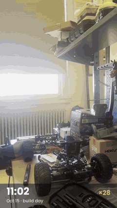

# f1tenth-umo

Build guide and code for the University of Maine F1TENTH car: a 1/10 RC car with a Jetson, VESC and Hokuyo lidar that maps a building by itself (SLAM Toolbox + Nav2 + a frontier explorer, ROS 2 Humble).

**Start with the [wiki](https://github.com/StepLogic/f1tenth-umo/wiki):** parts list, chassis build, Jetson and VESC setup, then running exploration.

## Build timelapse

[](media/f1tenth_build_timelapse.mp4)

The whole build in 2:36 ([full video, MP4](media/f1tenth_build_timelapse.mp4)). Step-by-step instructions are in the wiki, and every connection is on the [Wiring](https://github.com/StepLogic/f1tenth-umo/wiki/Wiring) page.

## Layout

| Folder | Contents |
|---|---|
| `config/` | VESC motor config, parts list, WireGuard config examples |
| `media/` | Build timelapse video and its preview, used by this README and the wiki |
| `f1tenth_exploration/` | Autonomous exploration: launcher, explorer, Nav2/SLAM/EKF configs, calibration tools |
| `remote_viz/` | Optional: RViz on your computer over WireGuard (Docker, ROS 2 Humble) |

## Quick start (on the car)

Once the [Jetson setup](https://github.com/StepLogic/f1tenth-umo/wiki/Jetson-Setup) is done (ROS 2 Humble and the F1TENTH driver stack in `~/f1tenth_ws`):

```bash
git clone https://github.com/StepLogic/f1tenth-umo.git ~/f1tenth-umo
ln -s ~/f1tenth-umo/f1tenth_exploration ~/f1tenth_exploration   # the scripts expect this path
cd ~/f1tenth_exploration
./run_exploration.sh --no-drive   # bring everything up without driving, then check it
./run_exploration.sh --attach     # explore
./run_exploration.sh --kill       # stop
```

The car drives itself: read the safety notes in [Running Exploration](https://github.com/StepLogic/f1tenth-umo/wiki/Running-Exploration) first.
